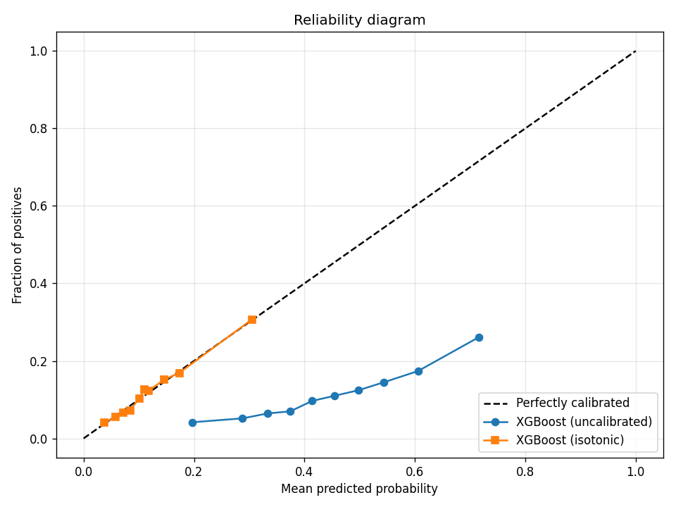
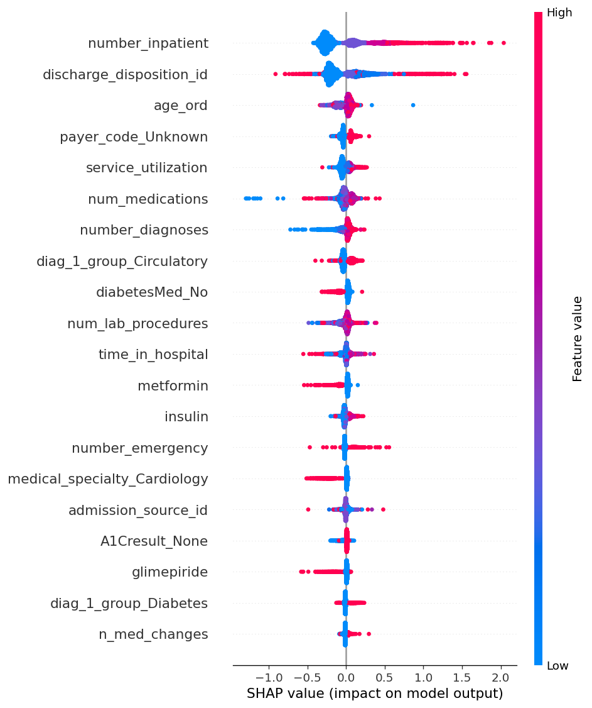

# Hospital Readmission Early Warning

[](https://github.com/boutouileabdelkrim-pixel/hospital-readmission/actions/workflows/ci.yml)
[](https://www.python.org/downloads/release/python-3110/)
[](https://opensource.org/licenses/MIT)
[](#testing)
[](https://mlflow.org/)

Predict 30-day hospital readmission risk from clinical data, with
calibrated probabilities, SHAP-based interpretability, and demographic
fairness analysis. Production-ready pipeline: MLflow tracking, FastAPI
serving, Docker, GitHub Actions CI.

---

## 🎯 Problem

Hospital readmissions within 30 days are costly and often preventable.
This project builds an early-warning system that flags high-risk
patients at discharge so care teams can prioritize follow-up.

- **Task** : binary classification (readmitted within 30 days: yes / no)
- **Dataset** : Diabetes 130-US hospitals (UCI ID 296, CC BY 4.0),
  101,766 encounters → 99,343 after cleaning, 198 engineered features
- **Class imbalance** : 11.4 % positive class
- **Primary metric** : PR-AUC (ROC-AUC as secondary)
- **Clinical priority** : high recall at controlled precision
- **Fairness** : per-group performance across age, gender, ethnicity

## 📊 Results

| Model | Split | PR-AUC | ROC-AUC | Brier |
|-------|-------|--------|---------|-------|
| XGBoost baseline | val | 0.2263 | 0.6663 | 0.2163 |
| LightGBM baseline | val | 0.2291 | 0.6658 | 0.2144 |
| **XGBoost tuned (Optuna)** | **val** | **0.2321** | 0.6655 | 0.2132 |
| XGBoost tuned | test | 0.2295 | 0.6733 | 0.2121 |

**Class imbalance handling**: `scale_pos_weight ≈ 7.78`. Random baseline
PR-AUC is 0.114, so the tuned model achieves **~2× lift**.

### Calibration

Isotonic regression on the validation set (5-fold cross-fit):

| | Brier (test) |
|--|--|
| Uncalibrated | 0.2120 |
| **Calibrated** | **0.0961** |

**−55 % Brier error** → probabilities are usable for clinical decision-making.



### Interpretability (SHAP)

Top-5 features by mean |SHAP|:

| # | Feature | Mean \|SHAP\| |
|---|---------|-------------|
| 1 | `number_inpatient` | 0.2784 |
| 2 | `discharge_disposition_id` | 0.2015 |
| 3 | `age_ord` | 0.0599 |
| 4 | `payer_code_Unknown` | 0.0571 |
| 5 | `service_utilization` (engineered) | 0.0520 |



### Fairness

| Group column | PR-AUC disparity ratio |
|--------------|------------------------|
| gender | **1.09** (near-equitable) |
| race | 1.71 (moderate) |
| age | 2.77 (driven by small groups) |

Full report: `reports/fairness_report.json`.

## 🏗️ Architecture

```
hospital-readmission/
├── src/
│   ├── data/           # download, validate, clean
│   ├── features/       # clinical feature engineering
│   ├── models/         # train_baseline, tune_optuna, log_mlflow, explain, calibrate, fairness
│   ├── api/            # FastAPI (schemas, model_loader, main)
│   ├── monitoring/     # Evidently drift
│   ├── tracking/       # MLflow helpers
│   └── utils/          # paths
├── tests/              # 100 pytest tests
├── docker/             # Dockerfile (multi-stage, uv-based)
├── reports/            # metrics, plots, drift reports
├── notebooks/          # EDA
├── .github/workflows/  # CI
├── pyproject.toml
└── Makefile
```

## 🚀 Quickstart

```bash
git clone git@github.com:boutouileabdelkrim-pixel/hospital-readmission.git
cd hospital-readmission
uv sync --all-groups

# Full pipeline (downloads 20 MB dataset from Kaggle fallback)
make data
make clean-data
make features
make train-baseline
make tune-xgb
make drift

# Tests
make test
make lint
```

### API

```bash
uv run uvicorn src.api.main:app --host 127.0.0.1 --port 8000

# Health check
curl http://127.0.0.1:8000/health

# Predict
curl -X POST http://127.0.0.1:8000/predict -H "Content-Type: application/json" -d @- <<JSON
{
  "race": "Caucasian", "gender": "Female", "age": "[60-70)",
  "admission_type_id": 1, "discharge_disposition_id": 1, "admission_source_id": 7,
  "time_in_hospital": 3, "payer_code": "MC", "medical_specialty": "Cardiology",
  "num_lab_procedures": 40, "num_procedures": 0, "num_medications": 12,
  "number_outpatient": 0, "number_emergency": 0, "number_inpatient": 1,
  "diag_1": "250.83", "diag_2": "428.0", "diag_3": "Unknown",
  "number_diagnoses": 7, "max_glu_serum": "None", "A1Cresult": "None",
  "metformin": "Steady", "repaglinide": "No", "nateglinide": "No",
  "chlorpropamide": "No", "glimepiride": "No", "acetohexamide": "No",
  "glipizide": "No", "glyburide": "No", "tolbutamide": "No",
  "pioglitazone": "No", "rosiglitazone": "No", "acarbose": "No",
  "miglitol": "No", "troglitazone": "No", "tolazamide": "No",
  "insulin": "Steady", "glyburide-metformin": "No",
  "glipizide-metformin": "No", "glimepiride-pioglitazone": "No",
  "metformin-rosiglitazone": "No", "metformin-pioglitazone": "No",
  "change": "Ch", "diabetesMed": "Yes"
}
JSON
```

## 🧪 Testing

```bash
make test   # 100 tests, ~10 s, no network, no large files
make lint   # ruff check + format
```

Tests use fixtures and mocks. No real dataset is required for `make test`.

## 🛠️ Stack

| Layer | Tools |
|-------|-------|
| Data | pandas, numpy, pyarrow |
| ML | scikit-learn, XGBoost 2.x, LightGBM 4.x, Optuna |
| Interpretability | SHAP, fairlearn, evidently |
| MLOps | MLflow 2.22, FastAPI, uvicorn, Docker |
| Quality | pytest, ruff, pre-commit, GitHub Actions |

## 📈 MLOps pipeline

1. **Data** : `make data` → UCI / Kaggle fallback → `data/raw/`
2. **Clean** : `make clean-data` → `data/processed/clean.parquet`
3. **Features** : `make features` → stratified 70/15/15 splits
4. **Baseline** : `make train-baseline` → XGBoost + LightGBM
5. **Tuning** : `make tune-xgb` → Optuna TPE, 20 trials
6. **Tracking** : `make mlflow` → `mlruns.db` (SQLite)
7. **Interpretability + Fairness** : `python -m src.models.explain|calibrate|fairness`
8. **Drift** : `make drift` → `reports/drift_report.html`
9. **Serve** : `uvicorn src.api.main:app`
10. **Containerize** : `make docker-build`

## ⚠️ Limitations

- No deep learning (tree-based only, justified by small dataset + interpretability)
- No NLP on clinical notes (dataset limitation)
- No real-time deployment (<100 ms target is met, but hosting out of scope)
- MIMIC-IV not used (restricted access, reproducibility requirement)
- Fairness on age is moderate (disparity 2.77) due to small under-18 and over-90 cohorts — documented, not corrected

## 📜 License

MIT — see LICENSE file.

## 🙏 Acknowledgements

- UCI ML Repository — Diabetes 130-US hospitals dataset
- SHAP, Optuna, MLflow, Evidently, FastAPI teams
